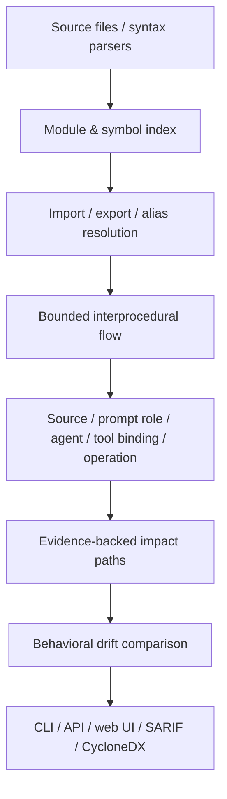

# Architecture

AIBOM Inspector is an offline-first static analysis pipeline. Scanned code is
read and parsed, but never imported or executed.

```text
CLI / HTTP API / web UI
  -> run_scan
     -> RepoCollector
        -> pre-pass: parse every .py / JS / TS file once -> ProjectIndex
           (module + symbol index, import/re-export/tsconfig-paths resolution)
        -> per-file detector registry (Python AST, JS/TS subset AST),
           each with ScanContext.project for bounded cross-file resolution
        -> legacy regex compatibility detector
        -> generic model-file detector
     -> DependencyCollector / LockfileCollector
     -> Inventory normalization and deduplication
     -> optional metadata/vulnerability resolvers
     -> exposure + agent capability impact paths (evidence level, nodes)
     -> deterministic risk rules and score
  -> JSON / CycloneDX / SARIF / graph / self-contained HTML

Baseline scan + candidate scan
  -> BOM comparison (identical? over which entity types?)
  -> path matching: prompt slot, then line/file/rename-insensitive semantic key
  -> exposure-path and impact-path comparison (added/removed/changed/unresolved)
  -> component / usage / finding comparison
  -> drift JSON, severity-gated CLI (unknown never gates), compare view in the UI
```



## Detector boundary

`Detector` implementations receive an immutable `ScanContext` and emit
`Detection` objects. Each detection contains a normal inventory entity with:

- a stable detector ID;
- `file:line[:column]` evidence;
- declared/imported/instantiated/invoked state;
- `true`/`false`/`unknown` reachability;
- confidence factors;
- a value-resolution path;
- production/test/example/docs source context.

The registry supports per-detector disabling. `RepoCollector` parses each
Python and JS/TS file once, in a pre-pass, and shares the resulting syntax
trees between detectors and with the cross-file `ProjectIndex`.

## Exposure paths and behavioral drift

`build_exposure_paths` derives a path only when a prompt is proven
`user_controlled=True`. A path records the source kind, trust boundary, provider
sink, prompt role, consuming model, reachability, sanitized resolution steps,
confidence, and file/line evidence. Prompt content is never copied.

`aibom diff` compares two independently scanned inventories. Prompt entities use
a line-insensitive slot identity—source file, role, sink, and same-kind ordinal—
so unrelated line movement does not become remove/add noise. A newly proven
untrusted path into a system/developer prompt is a high-severity
`exposure_added` change even when the two revisions have identical component
sets.

`build_impact_paths` is stricter than a graph reachability join. It requires a
confirmed privileged exposure plus a direct agent tool binding and a bounded
flow from a tool parameter into a recognized high-impact operation. The
derived `ImpactPath` records the model, tool, controlled parameter, operation,
severity, reachability, confidence, and source/sink/capability evidence.

## Cross-file analysis

`ProjectIndex` (`detectors/project.py`) holds every module parsed in a scan.
Detectors still run one file at a time; the index only answers "which module
and binding does this name refer to?" for the statically resolvable subset:

| Language | Resolved | Left unresolved |
|---|---|---|
| Python | `import a.b`, `from a.b import c`, `from ..x import y`, re-exports in `__init__.py`; unique module-name suffixes for `src/`-style layouts | `importlib`, `__import__`, `getattr`, methods on objects, ambiguous suffixes, single-segment names that are not project root modules |
| JS/TS | `./x`, `../x` (with extension and `index` resolution, `.js` meaning `.ts`), `export {a as b} from`, `export * from`, `import * as ns`, root `tsconfig`/`jsconfig` `paths` | bare package specifiers, dynamic `import()`, `extends`/project references, `export default function name` |

On top of it each language's tracer adds three steps, each recorded in the
prompt's `data_flow_path` with its own file and line:

- `call_argument` — a parameter of an ordinary function is bound to the
  argument at each resolved call site (up to 8 sites, 4 boundaries up);
- `call_return` / `return_value` — a call into a project function is traced
  through the callee's return expressions with its parameters bound to the
  call's arguments, so a helper that returns only literals sanitizes;
- `import_reference` — an imported module-level binding is followed to the
  module that defines it.

Tool bindings resolve imported tools (and imported `TOOLS` lists / barrels /
one level of tool factory), and capability search descends into project
helpers that receive a tool parameter. Reachability walks resolved callers to
an entrypoint in another file. A shared `Budget` caps visits per trace; cycles
are detected per module/function frame.

## Evidence levels

Every impact path has a `severity` (potential impact class of the reachable
operation) and an independent `evidence_level`:

| Level | Meaning | Gate |
|---|---|---|
| `proven_static` | every hop resolved; input is from a recognized untrusted source; route from an entrypoint resolved | may be Critical |
| `potential` | user-controlled, but taint crossed an `unresolved_call`, a bound was hit, or no entrypoint route was resolved | capped at High; `impact_severity` keeps the uncapped class |
| `unknown` | privileged prompt with a steerable bound tool whose input could not be resolved either way | INFO, never fails `--fail-on` |

## Compatibility migration

The legacy regex detector remains enabled. For syntactically valid Python,
provider/model invocation detection is owned by AST detectors while sanitized
source (comments and docstrings removed) still feeds legacy prompt, agent, MCP,
and risk-signal rules. If AST parsing fails, the complete legacy path runs and
the failure is recorded in `stats.parse_errors`.

Inventory identity remains `<entity type, normalized name>`, so existing entity
IDs and CycloneDX `bom-ref` values are stable. New analysis data is additive in
inventory JSON and is exported as `aibom:*` CycloneDX properties.

## Analysis policy view

The normalized inventory is complete across production, test, example, and
documentation contexts. Before risk evaluation, OSV mapping, graph projection,
or behavioral path synthesis, `production_view` removes entities and signals
that have only non-production evidence. It does not mutate or delete them from
the exported inventory. This prevents deliberately vulnerable golden fixtures
and detector source strings from becoming findings against the scanner that
contains them.

## Current detector modules

- `python.openai.ast`: OpenAI SDK, async/Azure clients, LangChain OpenAI.
- `python.anthropic.ast`: Anthropic SDK/Bedrock clients, LangChain Anthropic.
- `python.huggingface.ast`: Transformers, Diffusers, Datasets,
  SentenceTransformers, Hugging Face Hub, LangChain Hugging Face.
- `python.prompt-flow.ast`: OpenAI/Anthropic/OpenAI Agents SDK prompt sinks,
  sanitized source-to-sink paths, explicit agent tool bindings, and bounded
  tool-parameter-to-operation paths.
- `legacy.regex`: compatibility and non-Python textual patterns.
- `manifest.dependencies`: Python/npm dependency declarations.
- `generic.weight-file`: serialized local model files.

## Backward-compatibility risks

- JSON consumers using strict `additionalProperties: false` must allow the new
  analysis fields.
- Valid Python files no longer report model names found only in comments,
  docstrings, or unused string assignments. This is an intentional precision
  correction.
- Entities with the same type and name are still merged across files; every
  evidence location and source context is retained.
- Reachability is same-file only in this release. `unknown` is used when there
  is no supported entrypoint or static dispatch cannot be established.

## Next migration slices

1. Extract remaining agent and MCP rules from the compatibility detector into
   independently tested detectors.
2. Add cross-file symbol/configuration resolution for YAML, JSON, and TOML.
3. Expand the call graph across imports before treating reachability as a CI gate.
4. Add MCP capability nodes and cross-file prompt paths to the graph.
